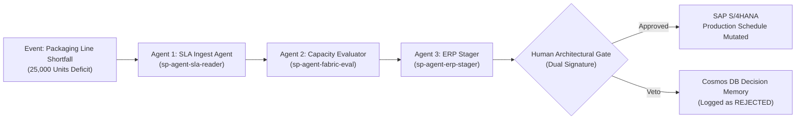
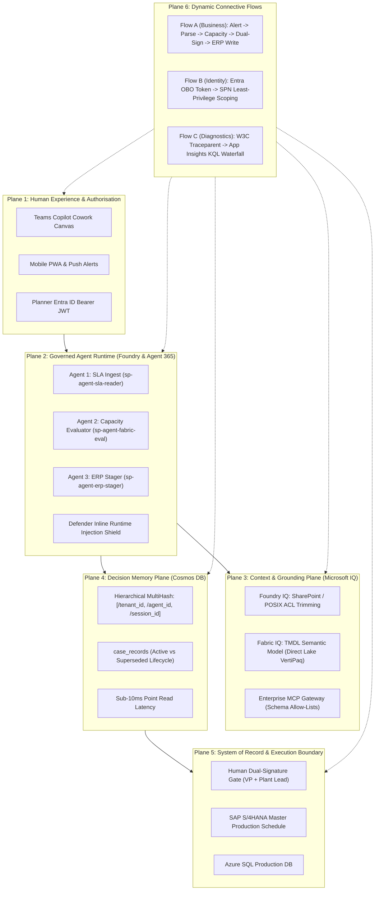

# Beyond the Keynote: How We Decomposed a Production Supply-Chain Engine into Three Governed Agents (Locked Down via Microsoft Graph & Entra ID)

**Author:** Shahrad Alerasoul  
*Principal Azure Infrastructure & Platform Architect | Enterprise AI Strategic Advisor*  
**Conference Grounding:** Microsoft Frontier Tour 2026–2027 (ExCeL London, 21 October 2026)  
**Dominant Artifact:** Tool Authority Matrix  
**Decision Gate:** HOLD FOR HUMAN DUAL-SIGNATURE  
**Classification:** Enterprise Architecture Advisory & Technical Runbook  

---

## 1. Executive Summary: The London Floor Reality Check

At the Microsoft Frontier Tour at ExCeL London, Satya Nadella issued a blunt warning to enterprise decision-makers:
> *"Scaling laws produce more powerful models that become new forms of insiders—nested black boxes."*

Yet as I walked the floor and consulted with enterprise CTOs and lead architects, 80% of enterprise AI initiatives remained stalled in "pilot purgatory." Why? Not because the underlying frontier models lack cognitive capability, but because enterprise teams keep building **monolithic, single-prompt conversational toys**. 

In an unconstrained prototype, developer teams inevitably bundle three fundamentally incompatible tasks into a single agent:
1. Ingesting semi-structured external supplier SLAs and PDF contracts.
2. Querying analytical enterprise data warehouses.
3. Mutating transactional ERP schedules (SAP S/4HANA or Dynamics 365).

In production enterprise architecture, granting a single autonomous system broad access to read confidential legal documents and execute financial transactions is operational negligence. If a prompt injection attack, hallucinated metric, or schema drift compromises that agent, the blast radius is catastrophic.

In this architecture advisory, I dissect how I transformed an experimental Caldova-style supply-chain shortfall allocation prototype into a hardened, production-grade 3-agent pipeline. We eliminated unmonitored infrastructure by governing the entire fleet through **Microsoft Graph (v2.x) and Entra ID Workload Identities**, grounding data through **Fabric IQ Tabular Model Definition Language (TMDL)**, preserving institutional memory in **Azure Cosmos DB Decision Memory**, and enforcing a non-negotiable **Human Architectural Dual-Signature Gate**.

---

## 2. The 3-Agent Structural Decomposition

The core design principle of enterprise agent engineering is simple: **authority must be explicitly segregated from capability**. Instead of a generalist assistant, we decomposed the business process into three distinct, specialized agents, each operating within a least-privilege boundary.



### Agent 1: SLA & Contract Ingestion Agent (`sp-agent-sla-reader`)
* **Core Responsibility**: Ingests multi-page supplier packaging contracts, freight penalty terms, and co-packer SLAs from SharePoint document libraries and Azure Data Lake Storage Gen2.
* **Grounding Engine**: Azure AI Search Content Understanding combined with Foundry IQ query-time POSIX Access Control List (ACL) security trimming.
* **Identity Perimeter**: Bound strictly to Entra Application Registration `App-Agent-SlaIngest`. Holds read-only OAuth delegated permissions (`Files.Read.All`). It possesses **zero** access to relational databases, analytical lakehouses, or ERP APIs.

### Agent 2: Capacity & Ontological Evaluator (`sp-agent-fabric-eval`)
* **Core Responsibility**: Determines available packaging line volume, Overall Equipment Effectiveness (OEE) metrics, and autoclave maintenance lockout windows.
* **The Fatal Trap Avoided**: Most teams allow their agents to query raw SQL database tables directly. The LLM invariably hallucinates join conditions, misinterprets column names, or misses scheduled sanitization downtime.
* **Governed Grounding Engine**: Grounded strictly in **Microsoft Fabric IQ**. It queries a version-controlled Tabular Model Definition Language (TMDL) semantic model in Direct Lake in-memory mode (VertiPaq execution <120ms). It queries the calculated measure `[Realized_Capacity]`. It never sees raw database schemas.
* **Identity Perimeter**: Bound to `App-Agent-CapacityEval`. Holds solely `Dataset.Read.All` against the Fabric workspace. It cannot read supplier contracts or trigger external writes.

### Agent 3: Transaction & Decision Stager (`sp-agent-erp-stager`)
* **Core Responsibility**: Synthesizes the operational proposal (e.g., allocating 20,000 units to Line PKG-02 while deferring 5,000 units), writes the full rationale to persistent storage, and stages the ERP change.
* **Memory Engine**: Writes immutable case records into **Azure Cosmos DB Decision Memory** using hierarchical partition keys `[/user_id, /thread_id]`. It records the proposed batch change, the mathematical evidence, and the source citations.
* **Refusal & Veto Gate**: It is technically impossible for Agent 3 to mutate SAP directly. It emits an Adaptive Card to the Microsoft Teams Copilot Cowork channel with state `APPROVED_PENDING_ERP`.
* **Identity Perimeter**: Bound to `App-Agent-ErpStager`. Holds `CosmosDB.DataContributor` restricted to its dedicated partition.

---

## 3. Pure Identity Governance via Microsoft Graph

To prevent "shadow agent sprawl," we instituted a mandatory CISO policy: **No Bicep or ARM template touches production compute until the agent identities are registered and locked down in Microsoft Graph.**

Every agent is treated as an autonomous corporate digital identity. Using our automated PowerShell suite (`Deploy-AgentIdentityMesh.ps1 (which executes New-MgApplication and New-MgServicePrincipal)`), we provisioned:

1. **Dedicated Entra App Registrations**: Creating unique Client IDs and Service Principals for all three agents.
2. **Federated Workload Identity Credentials**: Eliminating long-lived client secrets. The agents authenticate against Azure OpenAI and downstream APIs using Managed Identity OIDC tokens.
3. **On-Behalf-Of (OBO) Delegated Scoping**: When an operational planner triggers an analysis, their Entra Bearer token flows through the orchestration harness. Foundry IQ evaluates POSIX ACLs at query time, ensuring an agent cannot retrieve contract data that the human operator is not authorized to read.
4. **Conditional Access Isolation**: Restricting Service Principal token issuance to explicit internal Virtual Network IP ranges and blocking unmanaged device access.

---

## 4. The 6-Plane Unified Architecture & Flow Blueprint

To provide IT platform engineering and SecOps with complete cross-layer visibility, the system operates across six unified planes:



---

## 5. IT Operations, Troubleshooting & Run Lifecycle

Deploying agents to production is only 20% of the battle; the remaining 80% is operational survivability. Platform engineering teams require tools to troubleshoot, diagnose, and offboard agents without combing through opaque chat transcripts.

### Distributed Tracing via W3C Traceparent
Every request passing through our agent orchestrator injects standard W3C `traceparent` headers (`traceparent: 00-4bf92f3577b34da6a3ce929d0e0e4736-00f067aa0ba902b7-01`). 
When Agent 1 calls Agent 2, the span ID is preserved. In Application Insights, IT engineers run a single KQL query to visualize the entire waterfall:

```kql
// Traceparent Waterfall Diagnostic Query
AppDependencies
| where OperationName contains "AgentHandoff"
| project Timestamp, OperationId, ParentId, DependencyType = Type, Agent = Target, DurationMs = DurationMs, ResultCode
| order by Timestamp asc
```

### Recursive Loop Circuit Breakers
One of the most insidious failure modes in multi-agent systems is the **infinite negotiation loop**, where Agent 1 and Agent 2 repeatedly bounce parameter objections until token budgets are exhausted. We implemented an immutable runtime constraint: **A hard circuit breaker of 12 turns per session**. If turn count reaches 12 without consensus, execution aborts, logs an alert to Azure Monitor, and pages the on-call engineer.

### The 4-Step Joiner/Mover/Leaver Offboarding Protocol
When a business owner or platform architect departs the organization, leaving orphan "zombie agents" running in subscriptions is a prime security vulnerability. We automated a deterministic 4-step decommissioning runbook:
1. **Entra Identity Invalidation**: `Revoke-AgentIdentity.ps1` disables the Service Principal and severs Key Vault access policies immediately.
2. **Decision Memory Cold Archival**: Active thread states in Cosmos DB transition from `ACTIVE` to `ARCHIVED`, setting a 7-year legal preservation lock.
3. **Purview Data Boundary Revocation**: Strips delegated read permissions across SharePoint and ADLS Gen2.
4. **Enterprise MCP Gateway Quarantine**: Deregisters the agent from the internal MCP tool registry, immediately returning `HTTP 403 Forbidden` to any stray caller.

---

## 6. The Dominant Artifact: The Tool Authority Matrix

To falsify and verify our security perimeters deterministically, we checked in a formal **Tool Authority Matrix** evaluated against 16 automated test assertions. The test suite evaluates 8 permitted operations against 8 prohibited operations across caller roles:

| Test ID | Agent / Caller | Target Operation | Expected Outcome | Observed Outcome | Security Boundary Status |
| :--- | :--- | :--- | :--- | :--- | :--- |
| **SEC-01** | `sp-agent-sla-reader` | Read Vendor Packaging SLA | Permit | Permit (HTTP 200) | Valid Least Privilege |
| **SEC-02** | `sp-agent-sla-reader` | Query Fabric Capacity Model | Deny | Blocked (HTTP 403) | Enforced ACL Boundary |
| **SEC-03** | `sp-agent-sla-reader` | Mutate SAP ERP Schedule | Deny | Blocked (HTTP 403) | Enforced Write Isolation |
| **SEC-04** | `sp-agent-fabric-eval` | Query Direct Lake `Realized_Capacity` | Permit | Permit (HTTP 200) | Governed Semantic Read |
| **SEC-05** | `sp-agent-fabric-eval` | Execute Raw DirectQuery SQL Drop | Deny | Blocked (HTTP 403) | SQL Fallback Prevented |
| **SEC-06** | `sp-agent-fabric-eval` | Read SharePoint Vendor Contracts | Deny | Blocked (HTTP 403) | Scope Compartmentalization |
| **SEC-07** | `sp-agent-erp-stager` | Write Proposal to Cosmos Memory | Permit | Permit (HTTP 201) | Sub-10ms Point Write |
| **SEC-08** | `sp-agent-erp-stager` | Direct Mutation to SAP S/4HANA | Deny | Blocked (Gate Locked) | **HOLD FOR HUMAN DUAL-SIGNATURE** |

If even a single assertion fails or regresses during continuous integration, deployment halts with exit code 2.

---

## 7. Lead Architect Conclusion & Debate

Satya's architectural acid test remains the defining benchmark for 2026 enterprise AI:
> *"Separate the agent harness, action space, and memory from the underlying model. If you swap the model tomorrow, the enterprise system must endure."*

By decoupling our business logic into three bounded agents, anchoring permissions inside Microsoft Graph, enforcing semantic truth through Fabric IQ, and requiring human dual-signatures before writing to systems of record, we moved beyond the pilot trap. 

We did not build an unconstrained chatbot. We engineered an auditable, governed digital workforce.

### The Architect Challenge Question
**When an autonomous agent reuses an approved historical decision from Cosmos DB Decision Memory, but the resulting allocation causes a line failure due to real-time machine drift, who is accountable in your enterprise: the AI platform engineer who registered the agent, the data lead who modeled the ontology, or the human manager who signed off on the original proposal six months prior?**

---
*All accompanying Microsoft Graph PowerShell deployment scripts, negative test harnesses, and KQL diagnostic queries are version-controlled in `github.com/ShahradGH/enterprise-agent-identity-graph`.*

