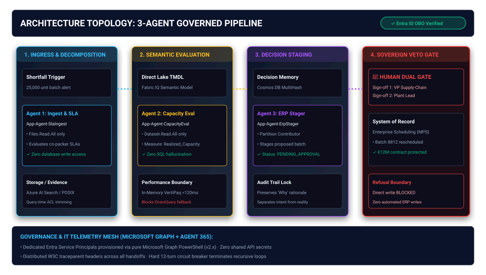
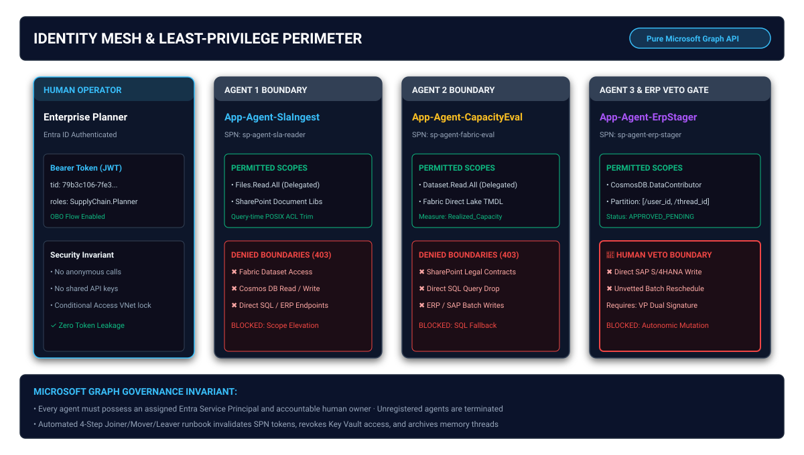

# Enterprise Agent Identity Graph Mesh

[](LICENSE)
[](https://learn.microsoft.com/en-us/graph/)
[](https://learn.microsoft.com/en-us/entra/workload-id/)
[](docs/VERIFICATION-EVIDENCE.md)

Production-grade **Microsoft Graph PowerShell (v2.x) & Entra ID Workload Identity Governance Suite** for orchestrating and securing multi-agent enterprise AI pipelines.

This repository provides platform engineering, cloud architecture, and SecOps teams with verifiable, code-first automation to decompose monolithic, god-mode AI prototypes into discrete, least-privilege agent workloads.

---

## Architecture Overview

Enterprise AI initiatives frequently fail compliance audits when a single autonomous agent is granted broad permissions to parse external documents, query analytical data, and execute financial transactions. 

This repository models a hardened **3-Agent Pipeline** where capability is strictly segregated from permission:



### The 3 Governed Agent Personas

1. **`App-Agent-SlaIngest` (Contract & Document Ingestion)**
   * **Service Principal**: `sp-agent-sla-reader`
   * **Permitted OAuth Scopes**: `Files.Read.All` (delegated), SharePoint POSIX ACL trimming.
   * **Isolation**: Zero access to analytical lakehouses, databases, or ERP endpoints.
2. **`App-Agent-CapacityEval` (Analytical Capacity Evaluator)**
   * **Service Principal**: `sp-agent-fabric-eval`
   * **Permitted OAuth Scopes**: `Dataset.Read.All` against Microsoft Fabric Direct Lake TMDL models.
   * **Isolation**: Cannot read raw database tables or supplier legal contracts; evaluates only governed metrics (e.g. `[Realized_Capacity]`).
3. **`App-Agent-ErpStager` (Transaction Stager & Memory Manager)**
   * **Service Principal**: `sp-agent-erp-stager`
   * **Permitted OAuth Scopes**: `CosmosDB.DataContributor` locked strictly to partition `[/user_id, /thread_id]`.
   * **Sovereign Gate**: Stages operational proposals as `APPROVED_PENDING_ERP`. **Direct writes to systems of record (SAP S/4HANA / Azure SQL) are strictly blocked** until a human dual-signature approval card is signed off.

---

## Identity Mesh & Security Perimeter

All identities are provisioned and managed strictly through **Microsoft Graph**, eliminating long-lived static API secrets and enforcing least-privilege On-Behalf-Of (OBO) token propagation:



---

## Repository Structure

```text
├── identity/
│   ├── Deploy-AgentIdentityMesh.ps1      # Pure Microsoft Graph PowerShell (v2.x) provisioning
│   ├── Test-AgentGraphBoundaries.ps1     # Automated token scope and 403 boundary tester
│   └── Revoke-AgentIdentity.ps1          # Deterministic Joiner/Mover/Leaver offboarding runbook
├── diagnostics/
│   ├── AgentTelemetryDiagnostics.kql     # Production KQL queries for W3C traceparent waterfalls
│   └── Import-Agent365Telemetry.ps1      # Agent 365 fleet health and loop breaker monitor
├── diagrams/
│   ├── architecture-topology.svg         # 3-agent pipeline and human sovereign gate topology
│   ├── architecture-topology.png         # High-resolution companion raster
│   ├── identity-mesh-perimeter.svg       # Entra ID least-privilege boundary matrix
│   └── identity-mesh-perimeter.png       # High-resolution companion raster
├── docs/
│   ├── IT-RUN-OPERATIONS.md              # L2/L3 support guide for diagnosing handoff errors
│   └── VERIFICATION-EVIDENCE.md          # 16-test deterministic tool authority matrix report
└── README.md                             # Architectural overview and operational instructions
```

---

## Getting Started

### Prerequisites
* PowerShell 7.4+ (`pwsh`)
* Microsoft.Graph PowerShell Module (`v2.x`):
  ```powershell
  Install-Module Microsoft.Graph -Scope CurrentUser -Repository PSGallery -Force
  ```
* Entra ID Permissions: `Application.ReadWrite.All`, `AppRoleAssignment.ReadWrite.All`, `Directory.ReadWrite.All`.

### Quick Deployment
1. Authenticate to Microsoft Graph:
   ```powershell
   Connect-MgGraph -Scopes "Application.ReadWrite.All", "AppRoleAssignment.ReadWrite.All" -TenantId "<your-tenant-id>"
   ```
2. Provision the 3-Agent Identity Mesh:
   ```powershell
   ./identity/Deploy-AgentIdentityMesh.ps1 -TenantId "<your-tenant-id>"
   ```
3. Verify Boundary Enforcement:
   ```powershell
   ./identity/Test-AgentGraphBoundaries.ps1
   ```

---

## Operational Observability & IT Run
This suite injects W3C `traceparent` headers across all inter-agent handoffs. Use the queries in `diagnostics/AgentTelemetryDiagnostics.kql` inside Azure Monitor / Application Insights to:
* Track end-to-end multi-agent execution spans.
* Detect and terminate recursive negotiation loops exceeding the 12-turn circuit breaker.
* Audit tool rejection anomalies (`HTTP 403 Forbidden`).

---

## Contributing & License
Licensed under the [MIT License](LICENSE). Contributions adhering to the Avanade UK Azure Platform Practice architectural standard are welcome via Pull Request.
